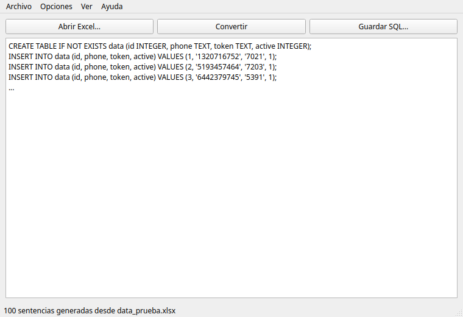
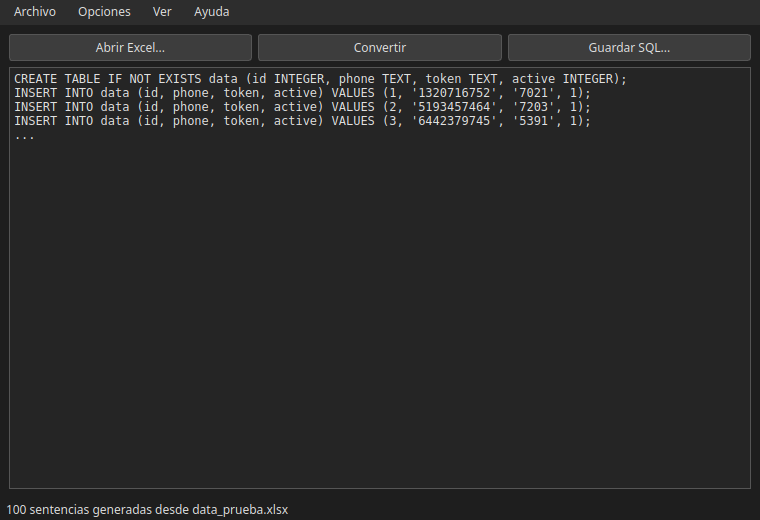
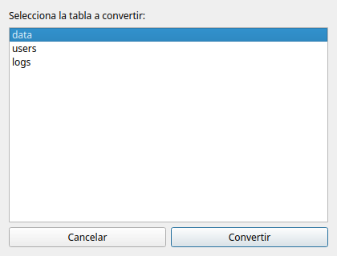
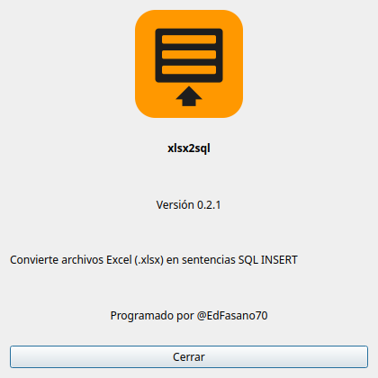

# xlsx2sql

Aplicación de escritorio con **PyQt6** que convierte archivos Excel (`.xlsx`) en
sentencias SQL `INSERT` y, opcionalmente, `CREATE TABLE`.



## Características

- Lee todas las hojas de un `.xlsx` y permite elegir la tabla a convertir en una
  ventana emergente.
- Genera un `INSERT` por fila.
- Opción checkable **Opciones → Incluir CREATE TABLE** para generar también la
  sentencia `CREATE TABLE IF NOT EXISTS` con los tipos inferidos de cada columna.
- Respeta el tipo real de cada celda usando openpyxl:
  - Números sin comillas.
  - Textos entre comillas (escapa apóstrofes).
  - `NULL` para celdas vacías.
  - Booleanos como `1`/`0`.
  - Fechas en formato ISO.
- Escapa nombres de tabla y columna, y descarta filas completamente vacías.
- Tema claro/oscuro.
- Preferencias guardadas en `~/.config/xlsx2sql/config.xml`.

## Capturas de pantalla

| Claro | Oscuro |
|-------|--------|
|  |  |

| Selección de tabla | Acerca de |
|--------------------|-----------|
|  |  |

## Requisitos

- Python 3.10+
- [PyQt6](https://pypi.org/project/PyQt6/)
- [openpyxl](https://pypi.org/project/openpyxl/)

## Instalación

```bash
python3 -m pip install --user --break-system-packages PyQt6 openpyxl
```

## Uso

```bash
python main.py
```

1. **Abrir Excel...** (`Ctrl+O`) y selecciona un archivo `.xlsx`.
2. Elige la tabla (hoja) a convertir en la ventana emergente.
3. Revisa el SQL generado y, si quieres, edítalo.
4. **Guardar SQL...** (`Ctrl+S`) para guardarlo en un archivo `.sql`.

Activa **Opciones → Incluir CREATE TABLE** para anteponer el `CREATE TABLE` a los
`INSERT`.

## Ejemplo

Con la opción `CREATE TABLE` activada, un Excel con la hoja `data`
(`id`, `phone`, `token`, `active`) genera:

```sql
CREATE TABLE IF NOT EXISTS data (id INTEGER, phone TEXT, token TEXT, active INTEGER);
INSERT INTO data (id, phone, token, active) VALUES (1, '1320716752', '7021', 1);
```

## Desarrollo

```bash
python3 -m pip install --user --break-system-packages pytest ruff
pytest
ruff check .
ruff format .
```

## Estructura

```
xlsx2sql/
├── main.py            # toda la app
├── resources/         # logo e iconos
├── screenshots/       # capturas de pantalla
├── src/               # vacío, para módulos futuros
├── tests/             # tests con pytest
├── pyproject.toml
└── README.md
```
